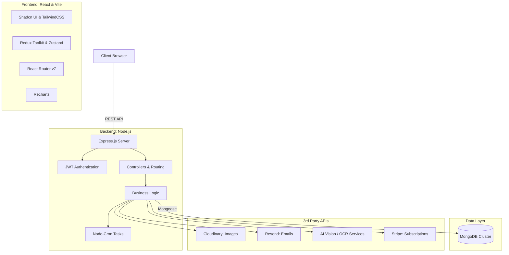

# 🌟 Finsathi: Advanced MERN AI Finance SaaS Platform

Welcome to **Finsathi** , a professional-grade Personal Finance and Wealth Management SaaS platform built on the MERN stack. Finsathi leverages Artificial Intelligence to deliver automated receipt scanning, intelligent reports, and comprehensive financial analytics.

## 📸 Platform Screenshots

<p align="center">
  
  
  
  
</p>

---

## 🚀 Key Features

*   **🔐 Secure Authentication**: Robust Email + Password login flow with JWT (JSON Web Tokens).
*   **🏢 Complete Transaction Management**: Seamlessly Create, Read, Update, and Delete transactions.
*   **📤 AI-Powered Receipt Scanning**: Upload images of receipts and instantly extract transaction data using AI.
*   **📈 Advanced Analytics & Dashboards**: Built with powerful MongoDB Aggregate Pipelines to generate real-time metrics.
*   **📊 Interactive Visualizations**: Features Beautiful Expenses Breakdown Pie Charts and Income vs. Expense Line Charts using Recharts.
*   **📅 Dynamic Filtering**: Easily filter data by custom date ranges (e.g., Last 30 Days, Year-to-Date).
*   **♻️ Recurring Transactions**: Automated transaction logging using robust Cron Jobs.
*   **📄 Automated Monthly Reports**: PDF/CSV reports automatically generated and emailed to users via Resend.
*   **📥 Seamless CSV Imports**: Bulk import legacy transaction data effortlessly.
*   **🔍 Powerful Search & Filters**: Instantly find specific transactions.
*   **🗑️ Bulk Actions & Duplication**: Optimize workflows with bulk deletes and one-click transaction duplication.
*   **🧑‍💼 Profile Customization**: Cloudinary integration for profile photo uploads.

---

## 📁 Project Structure

```text
Finsathi/
├── client/                 # Frontend (React/Vite)
│   ├── src/
│   │   ├── components/     # Reusable UI components (Navbar, Sidebar, ui/)
│   │   ├── pages/          # Application pages (Home, Overview, DashboardPreview)
│   │   ├── routes/         # React Router configurations
│   │   ├── store/          # Redux Toolkit state management
│   │   ├── lib/            # Utilities & Tailwind helpers
│   │   └── App.tsx         # Main entry point
│   ├── public/             # Static assets (images, videos)
│   └── package.json        # Frontend dependencies
├── backend/                # Backend (Node.js/Express)
│   ├── src/
│   │   ├── controllers/    # Request handlers & logic
│   │   ├── models/         # Mongoose Database Schemas
│   │   ├── routes/         # API Route definitions
│   │   ├── services/       # Business logic (AI receipt scanning, emails)
│   │   ├── middleware/     # Auth, Validation, & Error handling
│   │   └── index.ts        # Server entry point
│   ├── .env.example        # Environment variables template
│   └── package.json        # Backend dependencies
└── README.md               # Project documentation
```

---

## 🏗️ System Architecture

Finsathi utilizes a modern, decoupled architecture designed for scalability and performance.



---

## 🛠️ Technology Stack

| Category | Technologies |
| :--- | :--- |
| **Frontend Core** | React 19, Vite, TypeScript, React Router DOM |
| **Styling & UI** | Tailwind CSS v4, Shadcn UI, Radix Primitives, Lucide Icons |
| **State Management** | Redux Toolkit, Redux Persist |
| **Data Visualization** | Recharts |
| **Backend Core** | Node.js, Express.js |
| **Database** | MongoDB, Mongoose |
| **Authentication** | JSON Web Tokens (JWT), Bcrypt |
| **External Integrations** | Cloudinary (Media), Resend (Emails), Stripe (Billing) |

---

## 🔧 Getting Started

### 1. Prerequisites
Ensure you have the following installed:
*   Node.js (v18+)
*   MongoDB (Local or Atlas URL)
*   Stripe Account (for premium features)
*   Cloudinary Account (for media)

### 2. Environment Setup
Create a `.env` file in the root of the `/backend` directory matching `.env.example`:
```env
PORT=8000
MONGODB_URI=your_mongodb_uri
JWT_SECRET=your_secret
CLIENT_URL=http://localhost:5173
... (other keys)
```

### 3. Installation
**Backend:**
```bash
cd backend
npm install
npm run dev
```

**Frontend:**
```bash
cd client
npm install
npm run dev
```


